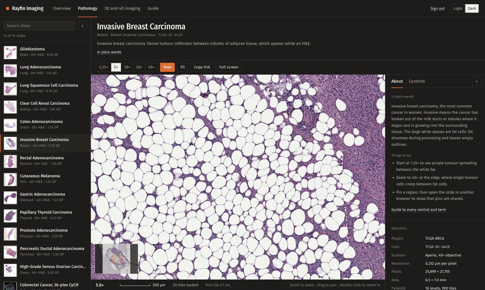
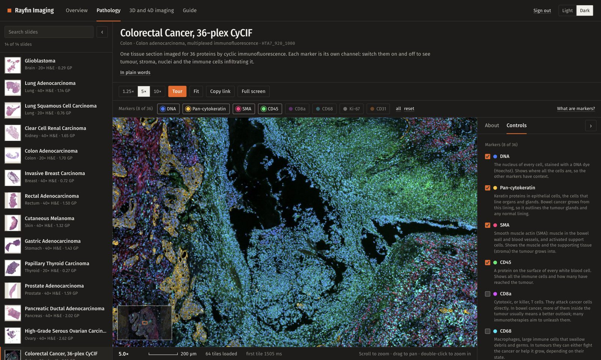
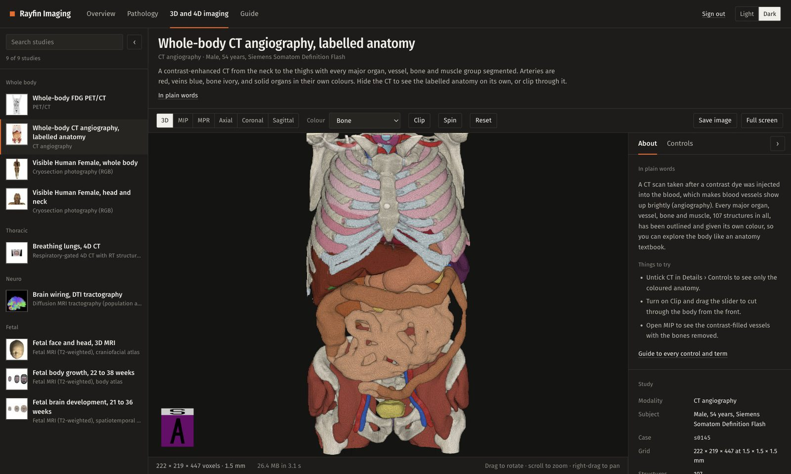
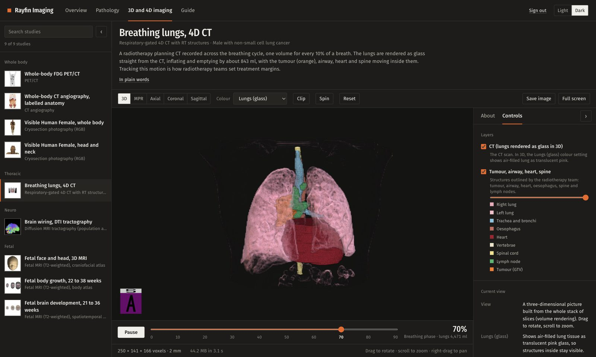
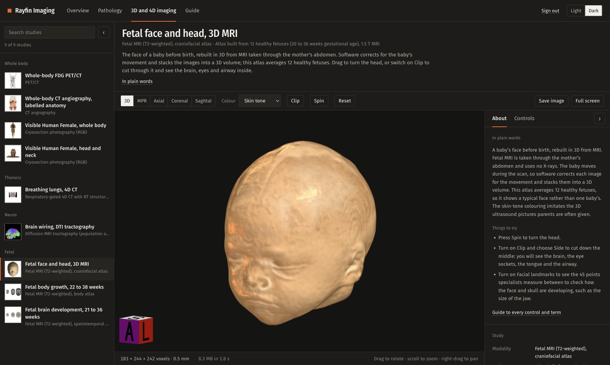
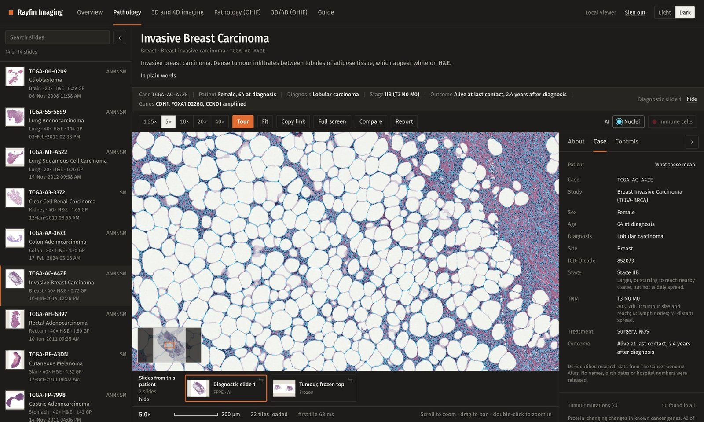
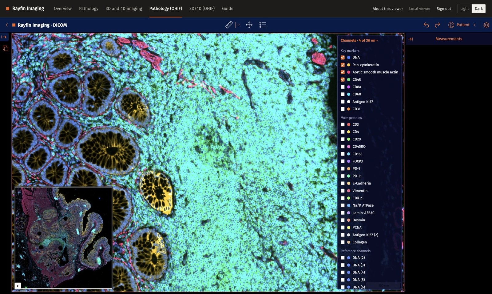
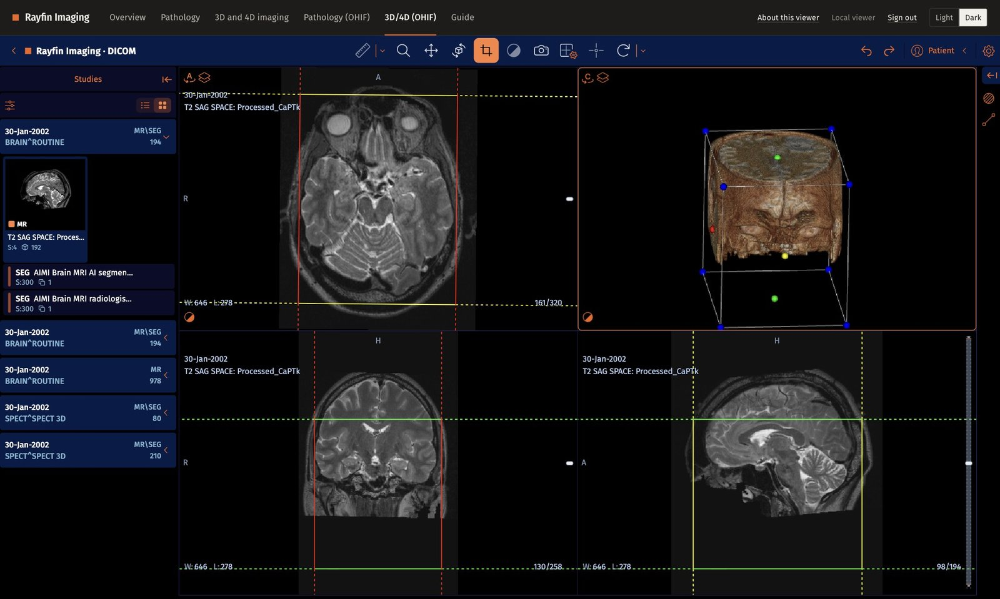

# Public patient imaging in 2D, 3D and 4D on Microsoft Fabric (Rayfin)

A browser-based medical image viewer built as a [Project Rayfin](https://www.npmjs.com/package/@microsoft/rayfin-cli)
app on Microsoft Fabric. Gigapixel pathology slides and 3D/4D radiology volumes live in a **Fabric
Lakehouse** in *your* workspace and stream from OneLake straight into the browser, with no image
server in between. The original DICOM files also open in the open-source [OHIF Viewer](https://ohif.org), read
straight from OneLake with no DICOMweb server.

> [!IMPORTANT]
> **For demonstration, education and research only.** This is not a medical device and must not be used for
> diagnosis, treatment or any clinical decision.
>
> **This repository hosts no data.** It contains only code, plus a few screenshots of the app for this README. Every image is downloaded by the setup
> pipeline directly from its original public publisher (listed under [Data sources](#data-sources)),
> under that publisher's licence, into your own Fabric Lakehouse.
>
> **Pull requests are welcome** to improve the viewer, the pipeline or this guide. See
> [Contributing](#contributing).

## Screenshots

| | |
|---|---|
|  |  |
| **Pathology:** gigapixel H&E slide with deep zoom and a plain-language explanation | **Multiplex immunofluorescence:** one colour per protein marker, switched on and off |
|  |  |
| **3D:** whole-body CT angiography with 107 labelled organs, vessels and bones | **4D:** breathing lungs as glass, with the tumour, airway and heart inside |
|  |  |
| **3D:** a fetal face rebuilt from MRI | **Patient case:** banner, AI nucleus outlines, the patient's other slides and the Case tab |
|  |  |
| **Pathology (OHIF):** the original DICOM CyCIF slide at full resolution, with all 36 channels | **3D/4D (OHIF):** brain MRI cut open with Crop 3D; the slice views show the cut |

The screenshots show public data credited under [Data attribution](#data-attribution): TCGA, HTAN (CC BY 4.0),
TotalSegmentator (CC BY 4.0), TCIA 4D-Lung (CC BY 3.0), the KCL craniofacial fetal MRI atlas (CC0),
Pan-Cancer-Nuclei-Seg (CC BY 4.0) and UPENN-GBM (CC BY 4.0).

## What you get

Six tabs, with collapsible side panels and a light/dark theme:

| Tab | What it shows |
|---|---|
| **Overview** | What the app is, what image types it reads, where the data sits in the Lakehouse (live sizes), and every dataset with its licence and citation. |
| **Pathology** | 13 TCGA cancer slides (H&E) and a 36-plex immunofluorescence slide at full resolution (0.65 µm per pixel) in an OpenSeadragon deep-zoom viewer: magnification presets, guided tour, scale bar, minimap, all 36 marker channels, shared pins and deep links. Each TCGA slide comes with its patient's case, laid out like a hospital imaging system (below). |
| **3D and 4D imaging** | NiiVue (WebGL 2): 3D volume rendering, MPR, single planes, rotating MIP, clip planes, colour transfer functions, layers (PET over CT, labelled anatomy), 4D playback and fibre tractography. |
| **Pathology (OHIF)** | The original DICOM whole-slide images (43 TCGA slides from 14 patients and the 36-channel CyCIF slide) and AI nucleus outlines in the OHIF Viewer's microscopy mode, with a channel picker for the fluorescence slide. |
| **3D/4D (OHIF)** | Original DICOM CT, PET and MRI with their segmentations and radiotherapy structures in the OHIF Viewer: PET/CT fusion, MPR, 3D, a **Crop 3D** tool and a breathing-phase player for the 4D CT. |
| **Guide** | Plain-language explanations of every image, control and term, for viewers without medical training. |

The Pathology and 3D and 4D lists start each case with the patient, the study type and the study date exactly as the
OHIF study list shows them, so the same case can be found in both.

**Patient case (TCGA slides).** All from the NCI Genomic Data Commons' open-access tier and the NCI Imaging Data
Commons, downloaded during setup:

- a **patient banner** (sex, age at diagnosis, diagnosis, stage and TNM, grade, outcome, headline gene changes)
- a **filmstrip** of every other slide published for the patient (30 more), and **Compare** for two slides side by
  side at the same real-world magnification
- the scanned, de-identified **pathology report** beside the slide
- **AI layers**: every cell nucleus outlined (Pan-Cancer-Nuclei-Seg) and a heat map of tumour-infiltrating immune
  cells (TCGA TIL maps)
- a **Case** tab: mutations in known cancer genes, gene copy changes, gene activity and the section's composition, all
  with plain-language notes

**OHIF tabs, no DICOMweb server.** A small Rayfin extension for OHIF reads OneLake directly: the study lists come from
a JSON index, CT, MR and PET files load whole, and each whole-slide tile is one HTTP range request into the original
`.dcm` file. Nothing is converted.

| OHIF tab | DICOM objects |
|---|---|
| Pathology (OHIF) | 43 TCGA slides (VL Whole Slide Microscopy), 16 Pan-Cancer-Nuclei-Seg bulk annotations, the HTAN CyCIF slide at every pyramid level |
| 3D/4D (OHIF) | FDG PET/CT with lesion SEG, 4D-Lung CT with RTSTRUCT, UPENN-GBM brain MRI with tumour SEG, PROSTATEx prostate MRI with zone SEG, NLST chest CT with an 81-structure TotalSegmentator SEG |

| 3D/4D study | What makes it worth showing |
|---|---|
| Whole-body FDG PET/CT | PET (SUV) over CT, 54 tumour deposits, expert lesion masks, rotating MIP |
| Whole-body CT angiography | 107 organs, vessels, bones and muscles labelled in colour; bone-free arterial MIP |
| Visible Human Female, body and head | true-colour volumes from 5,186 cryosection photographs |
| Breathing lungs, 4D CT | ten breathing phases; lungs rendered as glass around the tumour, airway and heart |
| Brain wiring, DTI tractography | 33,000 colour-coded fibre pathways from 1,065 people |
| Fetal face and head | a fetal face in 3D from MRI, with 45 craniofacial landmarks |
| Fetal body growth, 22 to 38 weeks | the trunk with nine labelled organs, week by week |
| Fetal brain development, 21 to 36 weeks | a 0.5 mm MRI atlas: the cortex folds as the brain grows 6.6-fold |

### Versions

| Tag | What it adds |
|---|---|
| `v1.0` | Overview, Pathology (OpenSeadragon), 3D and 4D imaging (NiiVue) and Guide; 8 of the 36 CyCIF markers at 1.3 µm. |
| `v2.0` | The two OHIF tabs over the original DICOM, Crop 3D, the TCGA patient case data, all 36 CyCIF channels at full resolution (0.65 µm), matching marker colours in both viewers, and local data mode (run on a laptop without Fabric). |

To use an earlier version: `git checkout v1.0`, or `git switch -c my-branch v1.0` to work from it.

---

## Setup guide for an AI agent

These steps are written so an AI coding agent (or a person) can take a fresh clone to a working app
in the user's own Fabric tenant. Run them in order from the repository root. Each step says what to
check before moving on.

### Step 0 — Ask the user (do not guess)

Ask these questions and wait for the answers before running anything that touches Fabric:

1. **What is the name of the Fabric workspace to deploy into?** It is used for the Lakehouse and the app.
2. **Does that workspace already exist?** If not, **which Fabric capacity should it use?** Step 4 lists
   the capacities the user can see. Any paid capacity (F2 or larger) or a trial works.
3. **Which datasets should be loaded?** The default is all of them: about 110 GB to download, about
   125 GB of local disk and about 95 GB in OneLake. Two sources make up most of it: the full-resolution
   CyCIF slide (67 GB, used by both pathology tabs) and the Visible Human Female (16.5 GB). Skipping
   them is the quickest way to cut time and space. See [Data sources](#data-sources).
4. Optionally, a Lakehouse name (default `imaging_lakehouse`) and an app item name (default `rayfin-imaging`).

Tell the user that signing in (steps 3 and 7) opens a browser window they must complete themselves.

### Step 1 — Check prerequisites

| Tool | Version | Check |
|---|---|---|
| Node.js | 24 (the OHIF build needs 24 or later; the Rayfin CLI supports 20, 22 and 24) | `node -v` |
| Python | 3.11 or newer | `python3 --version` |
| Azure CLI | any recent | `az version` |
| AzCopy | v10 | `azcopy --version` |
| Disk space | about 130 GB free for everything, about 45 GB without the CyCIF slide and the Visible Human | |
| Git | any recent (the OHIF build clones OHIF from GitHub) | `git --version` |
| Fabric | a workspace on an **active** capacity; Fabric Apps (Rayfin) enabled in the tenant | |

The tenant setting **"Use short-lived user-delegated SAS tokens"** (Fabric admin portal, OneLake settings)
lets the browser stream straight from OneLake. Without it the app still works through a slower proxy
function. Ask a Fabric admin to enable it if it is off.

### Step 2 — Install dependencies

```bash
npm install
(cd rayfin/functions && npm install)
python3 -m venv .venv
.venv/bin/pip install -r pipeline/requirements.txt
```

Check that `npx rayfin --version` prints a version, and that `.venv/bin/python -c "import openslide, nibabel, idc_index"` exits cleanly.

### Step 3 — Sign in

```bash
az login                 # used by the setup script, AzCopy and the Lakehouse table loads
npx rayfin login         # used by `rayfin up`; opens a browser account picker
```

Use the same account for both. It must be able to create items in the target workspace (Admin, Member or Contributor).

### Step 4 — Prepare the workspace and Lakehouse

```bash
# Look first (read-only): shows the workspace, its capacity and whether the Lakehouse exists.
.venv/bin/python scripts/setup_fabric.py --workspace "<workspace name>" --dry-run

# Existing workspace:
.venv/bin/python scripts/setup_fabric.py --workspace "<workspace name>"

# New workspace (the error message from --dry-run lists the capacity IDs you can use):
.venv/bin/python scripts/setup_fabric.py --workspace "<workspace name>" --create --capacity-id <capacity GUID>
```

The script finds or creates the workspace and assigns a capacity if it has none. It then creates the
Lakehouse (`--lakehouse <name>` to change the name) and writes the IDs to two places:

- `fabric.env` at the repository root (git-ignored), read by every pipeline script
- the `<lakehouse-config>` block in `rayfin/functions/src/function_app.ts`, used by the deployed functions

If it reports that the capacity is paused, ask the user to resume it in the Azure portal, then run it again.

### Step 5 — Download the public data

Everything lands in `work/`, which is git-ignored. Downloads can be resumed: re-running skips files that already exist.

```bash
.venv/bin/python pipeline/download_slides.py                  # 13 TCGA H&E slides from the NCI GDC (about 1.6 GB)
.venv/bin/python pipeline/download_data.py all                # 3D/4D sources (about 18 GB)
# or choose: petct lung4d vhp tracts fetal
.venv/bin/python pipeline/build_cases.py fetch                # patient case data and 30 more slides from the GDC (about 7 GB)
.venv/bin/python pipeline/dicom/download_dicom.py --only radiology   # MRI and CT studies for 3D/4D (OHIF) from IDC (0.4 GB)
.venv/bin/python pipeline/dicom/download_dicom.py --only cycif       # the CyCIF slide, every level of 36 channels (67 GB)
```

- **TotalSegmentator:** the whole-body CT angiography is fetched later by its builder (`build_totalseg.py`), which
  reads one subject out of the Zenodo archive with HTTP range requests.
- **Original slides:** the DICOM versions of the TCGA slides are downloaded in step 6, once the case data has
  listed each patient's slides.
- **Nothing is converted:** the DICOM files are kept as published.

### Step 6 — Build, upload and register the data

Run these in order: later steps read what earlier ones write.

```bash
# Pathology slides and patient cases
.venv/bin/python pipeline/generate_tiles.py --raw work/raw --out work/lakehouse   # Deep Zoom tiles (minutes per slide)
.venv/bin/python pipeline/build_cases.py tile                 # tiles for each patient's other slides
.venv/bin/python pipeline/build_cases.py overlays             # AI layers from IDC: nucleus outlines, immune-cell maps
.venv/bin/python pipeline/build_cases.py assemble             # each slide's case.json
.venv/bin/python pipeline/build_multiplex.py                  # CyCIF: 36 marker pyramids at full resolution

# 3D and 4D volumes: run the builders for the datasets you downloaded
.venv/bin/python pipeline/volumes/build_petct.py
.venv/bin/python pipeline/volumes/build_totalseg.py
.venv/bin/python pipeline/volumes/build_visible_human.py
.venv/bin/python pipeline/volumes/build_lung4d.py
.venv/bin/python pipeline/volumes/build_tractography.py
.venv/bin/python pipeline/volumes/build_fetal_face.py
.venv/bin/python pipeline/volumes/build_fetal_body.py
.venv/bin/python pipeline/volumes/build_fetal_atlas.py
.venv/bin/python pipeline/volumes/build_mip.py          # after PET/CT and CT angiography

# Original DICOM for the OHIF tabs
.venv/bin/python pipeline/dicom/download_dicom.py --only pathology   # every slide of those patients + nucleus annotations (about 11 GB)
.venv/bin/python pipeline/dicom/build_dicom.py          # study lists, DICOM JSON, thumbnails, slide tile offsets

# Catalogs: each case also gets its OHIF study (patient, date, type) for the lists
.venv/bin/python pipeline/generate_tiles.py --raw work/raw --out work/lakehouse --only none
.venv/bin/python pipeline/volumes/build_manifest.py

# Upload to OneLake and register the Delta tables
pipeline/upload_to_onelake.sh --raw
pipeline/volumes/upload_volumes.sh --raw
pipeline/dicom/upload_dicom.sh                          # → Files/dicom (about 80 GB)
.venv/bin/python pipeline/register_catalog_table.py                               # Delta table `slides`
.venv/bin/python pipeline/volumes/register_volume_table.py                        # Delta table `volumes`
```

- **Builders:** skip the builder of any dataset you did not download. The manifests list only what was built.
- **Memory:** `build_multiplex.py` holds one full-resolution channel per worker (about 8 GB each, 3 workers by
  default). On a 16 GB machine use `--workers 1`.
- **Order:** `build_dicom.py` reads each CyCIF channel's colour window from `build_multiplex.py`, so both viewers show
  the same colours; the two catalog commands read the DICOM index.
- **`--raw`:** this flag also copies the original files into `Files/raw/` for lineage. Leave it off to save space.
- **Check:** the Lakehouse in Fabric shows `Files/slides`, `Files/volumes`, `Files/dicom`, `Files/manifest.json` and the
  `slides` and `volumes` tables.

### Step 7 — Deploy the app

```bash
node ohif/build.mjs                    # the OHIF Viewer for the OHIF tabs → public/ohif (Node 24; minutes the first time)
npx rayfin up -w "<workspace name>" -y
```

`ohif/build.mjs` clones OHIF v3.13.13 from GitHub into `ohif/.build/` (git-ignored), adds the Rayfin extension in
`ohif/extension-rayfin/`, applies the one small patch in `ohif/patches/` and builds it into `public/ohif/` (also
git-ignored), which `rayfin up` deploys with the app.

`rayfin up` creates the Rayfin app item, its database (shared pins), the functions and the static site. Then:

- **Check:** the command ends with *"Your app is live at: https://…fabricapps.net"*. Give that URL to the user. It needs Fabric (Entra) sign-in.
- **`rayfin.yml`:** the first deploy appends the hosting URL to `rayfin/rayfin.yml` (`allowedRedirectUris`). Keep it locally, but don't commit it to a public fork.
- **Redeploying:** after a code change, run `npx rayfin up -w "<workspace name>" -y` again. Add `--exclude-services functions` when only the UI changed.

### Step 8 — Verify

Open the URL and sign in, then check each tab:

- **Overview:** lists the datasets and Lakehouse sizes.
- **Pathology:** each slide opens and zooms; a TCGA slide shows its patient banner and filmstrip.
- **3D and 4D imaging:** each built study renders.
- **Pathology (OHIF)** and **3D/4D (OHIF)**: the study lists show 14 and 9 studies, and a study opens when you
  double-click it.

If a tab says it could not read the catalog, check two things:

- **IDs:** step 4 wrote the right IDs, and step 7 was run after step 4.
- **Access:** the deploying account (the app identity) can read the workspace.

### Troubleshooting

| Symptom | Fix |
|---|---|
| `rayfin` errors about the Node version | Use Node 24 (the Rayfin CLI supports 20, 22 and 24; the OHIF build needs 24). |
| `CapacityNotActive` or "capacity is paused" | Resume the capacity in the Azure portal. |
| The functions log "Lakehouse not configured" | Run step 4, then redeploy (step 7). |
| Tiles load slowly through the proxy | Enable the tenant setting "Use short-lived user-delegated SAS tokens". |
| An IDC download fails | Re-run `download_data.py <dataset>` or `download_dicom.py --only <part>`: both resume. IDC data is served from public cloud buckets and needs no login. |
| Upload scripts say WORKSPACE_ID is not set | Run step 4, or export `WORKSPACE_ID` and `LAKEHOUSE_ID`. |
| An OHIF tab says the viewer has not been built | Run `node ohif/build.mjs` (Node 24 or later), then redeploy. |
| `build_multiplex.py` is killed or runs out of memory | Re-run it with `--workers 1`. |
| An OHIF tab lists no studies | Run `pipeline/dicom/upload_dicom.sh`; the study lists are in `Files/dicom/<pathology\|radiology>/studies.json`. |

---

## Data sources

All data is public, de-identified and downloaded from its publisher at setup time. **This repository
contains none of it.** Every licence below allows reuse with attribution, including commercial use.
Check the current terms at each source before you rely on them.

| Dataset | Used for | Licence | Downloaded by | Size |
|---|---|---|---|---|
| [The Cancer Genome Atlas](https://portal.gdc.cancer.gov/) (NCI GDC, open-access tier) | 13 H&E slides | NIH GDC open access, attribution | `download_slides.py` | 1.6 GB |
| The Cancer Genome Atlas (NCI GDC, open-access tier) | patient case: de-identified clinical data, mutations, copy number, gene expression, pathology reports and 30 more slides | NIH GDC open access, attribution | `build_cases.py fetch` | 7 GB |
| [Pan-Cancer-Nuclei-Seg](https://doi.org/10.7937/tcia.2019.4a4dkp9u) and [TCGA TIL maps](https://doi.org/10.7937/K9/TCIA.2018.Y75F9W1) via IDC | AI layers: nucleus outlines and immune-cell maps | CC BY 4.0 | `build_cases.py overlays` | 0.1 GB |
| [HTAN HMS CyCIF](https://portal.imaging.datacommons.cancer.gov/collections/htan_hms/) via NCI Imaging Data Commons | 36-plex immunofluorescence slide at full resolution, both pathology tabs | CC BY 4.0 | `download_dicom.py --only cycif` | 67 GB |
| TCGA slides in DICOM, [IDC](https://portal.imaging.datacommons.cancer.gov/) | Pathology (OHIF): 43 slides from the 13 patients | CC BY 3.0 | `download_dicom.py --only pathology` | 9.1 GB |
| [Pan-Cancer-Nuclei-Seg-DICOM](https://doi.org/10.5281/zenodo.11099004) via IDC | Pathology (OHIF): nucleus annotations | CC BY 4.0 | `download_dicom.py --only pathology` | 1.6 GB |
| [UPENN-GBM](https://doi.org/10.7937/TCIA.709X-DN49) with [BAMF AIMI segmentations](https://doi.org/10.5281/zenodo.8345959) via IDC | 3D/4D (OHIF): brain MRI and tumour regions | CC BY 4.0 | `download_dicom.py --only radiology` | 0.2 GB |
| [PROSTATEx](https://doi.org/10.7937/K9TCIA.2017.MURS5CL) with [zone segmentations](https://doi.org/10.7937/TCIA.NBB4-4655) via IDC | 3D/4D (OHIF): prostate MRI | CC BY 3.0 and 4.0 | `download_dicom.py --only radiology` | 0.03 GB |
| [NLST](https://www.cancerimagingarchive.net/collection/nlst/) with [TotalSegmentator segmentations](https://doi.org/10.5281/zenodo.8347011) via IDC | 3D/4D (OHIF): chest CT with 81 structures | CC BY 4.0 | `download_dicom.py --only radiology` | 0.15 GB |
| [TCIA FDG-PET-CT-Lesions](https://doi.org/10.7937/gkr0-xv29) via IDC | whole-body PET/CT | CC BY 4.0 | `download_data.py petct` | 0.3 GB |
| [TotalSegmentator v2.0.1](https://zenodo.org/records/10047292) | CT angiography with 107 labels | CC BY 4.0 | `build_totalseg.py` | 0.1 GB |
| [NLM Visible Human Project](https://www.nlm.nih.gov/research/visible/) | Visible Human Female | Public domain (NLM terms) | `download_data.py vhp` | 16.5 GB |
| [TCIA 4D-Lung](https://doi.org/10.7937/K9/TCIA.2016.ELN8YGLE) via IDC | breathing 4D CT | CC BY 3.0 | `download_data.py lung4d` | 0.8 GB |
| [HCP1065 tractography atlas](https://brain.labsolver.org/hcp_trk_atlas.html) and [TemplateFlow](https://www.templateflow.org/) ICBM 2009a | tractography | CC BY-SA 4.0; ICBM template permissive with attribution | `download_data.py tracts` | 0.6 GB |
| [dHCP fetal brain atlas](https://gin.g-node.org/kcl_cdb/fetal_brain_mri_atlas) (King's College London) | fetal brain | CC0 | `download_data.py fetal` | 0.25 GB |
| [KCL 0.55T fetal body atlas](https://gin.g-node.org/kcl_cdb/055t_fetal_mri_atlases) | fetal body | CC0 | `download_data.py fetal` | 0.1 GB |
| [KCL craniofacial fetal atlas](https://gin.g-node.org/kcl_cdb/craniofacial_fetal_mri_atlas) | fetal face | CC0 | `download_data.py fetal` | 0.02 GB |

The PET/CT and 4D-Lung DICOM downloaded for the 3D and 4D tab are reused by 3D/4D (OHIF). The exact series,
instances and files are pinned in `pipeline/download_data.py`, `pipeline/dicom/download_dicom.py`,
`pipeline/build_cases.py`, `pipeline/slides.json` and `pipeline/sources/`. The GDC queries request open-access files
only, and the IDC downloads keep only series whose licence allows commercial use. Each dataset's citation is shown in the app (the study's About tab, and the Overview) and under
[Data attribution](#data-attribution).

## Open-source software

The app and pipeline use only open-source software:

- **Viewers:** [NiiVue](https://github.com/niivue/niivue) (BSD-2-Clause) and [OpenSeadragon](https://openseadragon.github.io/) (BSD-3-Clause).
- **OHIF tabs:** [OHIF Viewer](https://github.com/OHIF/Viewers) v3.13.13 with Cornerstone3D,
  [dicom-microscopy-viewer](https://github.com/ImagingDataCommons/dicom-microscopy-viewer) and dcmjs (all MIT), and
  OpenLayers (BSD-2-Clause). OHIF is cloned from GitHub at build time and not stored here; this repository holds only
  the Rayfin extension and an 8-line patch to OHIF's MIT-licensed microscopy extension.
- **Report viewer:** [PDF.js](https://mozilla.github.io/pdf.js/) (Apache-2.0).
- **UI:** React, React Router, Radix UI, shadcn/ui and Tailwind CSS (all MIT).
- **Fonts:** Fira Sans, Fira Sans Condensed and Fira Mono, via @fontsource (SIL OFL 1.1).
- **Fabric SDK:** the Rayfin SDK and CLI packages (`@microsoft/rayfin-*`, `@microsoft/fabric-user-data-functions`) are MIT-licensed on npm, as are the agent skills they generate under `.agents/skills/`.
- **Python pipeline:** OpenSlide (LGPL-2.1, used as an unmodified library), nibabel (MIT), SimpleITK (Apache-2.0), pydicom (MIT), NumPy, SciPy and pandas (BSD), Pillow (MIT-CMU), idc-index (MIT), remotezip (MIT), and the Azure SDKs (MIT). Downloads use public HTTPS and S3 endpoints of the GDC and IDC, with no login.
- **Audit:** a licence audit of every installed npm package found only permissive licences: MIT, ISC, Apache-2.0, BSD, 0BSD, BlueOak, MPL-2.0, OFL-1.1, CC-BY-4.0 and Unlicense.

Running the app needs a **Microsoft Fabric** subscription, which is a commercial cloud service. This
repository contains no Microsoft proprietary code; it only calls Fabric's public APIs and SDKs.

This project's own code is released under the [MIT License](LICENSE).

## Contributing

Pull requests are welcome, whether new public datasets, viewer features, accessibility, pipeline
robustness or clearer docs. Please:

- **Data:** only add datasets that are public, need no login or data-use agreement, and whose licence
  allows reuse including commercial use (CC0, public domain, CC BY, CC BY-SA). No non-commercial
  (NC) or no-derivatives (ND) data.
- **Commits:** never commit images, derived data, workspace or Lakehouse IDs, hosting URLs or keys.
  `work/`, `fabric.env`, `rayfin/.env*` and `rayfin/.deployments.json` are ignored for this reason.
  Reset the `<lakehouse-config>` block in `function_app.ts` to its zero GUIDs before committing.
- **Plain-language notes:** add an explanation for any new slide or study in `src/content/guide.ts`.
- **OHIF tabs:** only genuine DICOM, as published; never convert other formats into DICOM for them.
- **Checks:** run `npx tsc -b` and `npm test` before opening the PR.

---

## How it works

```
Public sources (GDC, IDC, Zenodo, NLM, GIN, GitHub, TemplateFlow)
        │  pipeline/download_slides.py, download_data.py, build_cases.py fetch, dicom/download_dicom.py
        ▼
work/  (local only)  ── pipeline/generate_tiles.py, build_cases.py, build_multiplex.py, volumes/build_*.py
        │                → Deep Zoom pyramids, NIfTI volumes, TRK fibres, MIP sprites, manifests
        │  upload_to_onelake.sh, volumes/upload_volumes.sh (AzCopy)
        ▼
Fabric Lakehouse (your workspace)
   ├─ Files/slides/…, Files/manifest.json          slide tiles and catalog
   ├─ Files/volumes/…, Files/volumes/manifest.json volumes and catalog
   ├─ Files/dicom/…                                original DICOM and its index (OHIF tabs, below)
   ├─ Files/raw/…                                  originals (optional, --raw)
   └─ Tables/slides, Tables/volumes                catalogs as Delta tables (SQL / Power BI)
        ▲
        │  Rayfin functions getSlideCatalog / getVolumeCatalog (app identity):
        │  read the manifests and sign 55-minute, read-only, folder-scoped OneLake SAS tokens
        ▼
Browser (Rayfin static hosting, Entra sign-in): React + OpenSeadragon + NiiVue
        └─ streams only the tiles and volumes in view straight from OneLake
           (fallback: the getTiles function proxies tiles if SAS is unavailable)
```

Shared pins are stored in the app's own database through Rayfin's data API, with row-level security
per author.

The OHIF tabs read the original DICOM the same way, with no DICOMweb server:

```
NCI Imaging Data Commons: TCGA and HTAN slides (DICOM SM), Pan-Cancer-Nuclei-Seg (ANN),
PET/CT, 4D-Lung, UPENN-GBM, PROSTATEx, NLST (CT, MR, PT, SEG, RTSTRUCT)
        │  pipeline/dicom/download_dicom.py          (nothing is converted)
        │  pipeline/dicom/build_dicom.py             (indexes only; the .dcm files are hard links)
        ▼
Files/dicom/<pathology|radiology>/
   ├─ studies.json, studies/<study>.json             study lists and series lists
   ├─ series/<series>/metadata.json                  DICOM JSON, no pixel data; large values as byte ranges
   ├─ series/<series>/thumbnail.jpg, display.json    previews; fluorescence starting display
   └─ files/<series>/<sop>.dcm (+ .frames)           original files; slide tile byte offsets
        ▲
        │  Rayfin function getDicomAccess (app identity): read-only SAS for Files/dicom
        ▼
Browser: OHIF Viewer (static files in dist/ohif, framed by the app) with @rayfin/ohif-extension
        ├─ CT, MR, PET, SEG, RTSTRUCT: Cornerstone3D loads each .dcm from OneLake
        └─ slides: dicom-microscopy-viewer asks for tiles; the extension answers with HTTP range reads
```

## Demo script (about 15 minutes)

1. **Overview**: one Lakehouse holds gigapixel slides and whole-body scans, all public data, served from OneLake.
2. **Pathology** › *Invasive Breast Carcinoma*: zoom from fat lobules to tumour cells at 40×. Press **Tour** on *Clear Cell Renal Carcinoma*.
3. Pin a region, then open the slide in a second browser to show the pin is shared.
4. *Colorectal Cancer, 36-plex CyCIF*: switch on **CD8a** and **CD68** to show immune cells in the tumour, then zoom
   to 20× to see single cells at full resolution.
5. *Invasive Breast Carcinoma*: read the patient banner, open **Report**, switch on the **Nuclei** AI layer and open
   the **Case** tab for the tumour's gene changes.
6. **3D and 4D imaging** › *Whole-body FDG PET/CT*: press **Spin**, then open **MIP** and **MPR**.
7. *Whole-body CT angiography*: untick **CT**, turn on **Clip**, then open **MIP** for the arteries.
8. *Breathing lungs, 4D CT*: glass lungs breathe around the tumour. Press **Spin**.
9. *Brain wiring*: rotate the fibres and switch bundle groups off in Details › Controls.
10. *Visible Human Female*: drag the clip slider through the body in true colour.
11. *Fetal face*, *Fetal body growth* and *Fetal brain development*: press **Play**.
12. **3D/4D (OHIF)**: "the same kind of data as the original DICOM, in the standard open-source viewer, read
    straight from OneLake". Open *PETCT_5e2da717db* in **Total Metabolic Tumor Volume** for PET/CT fusion. Open a
    *UPENN-GBM-00085* study in **Basic Viewer**, choose **Layout › 3D four up**, press **Crop 3D** and drag the top
    handle down to cut into the brain. Open *P100* (4D-Lung) and press **Play** on the breathing-phase bar.
13. **Pathology (OHIF)**: open *TCGA-AC-A4ZE* in **Microscopy**, pick the diagnostic slide (FFPE HE DX1), then
    double-click the annotation series for the AI nucleus outlines. Open *HTA7_920* for the CyCIF slide.
14. **Guide**: the plain-language explanations for a non-clinical audience.

## Local development

```bash
npm run dev          # Rayfin local backend + Vite, with a mock sign-in
npx tsc -b && npm test
```

The local backend has no Lakehouse data. To see images without Fabric, use local data mode.

### Run it on your laptop, without Fabric (local data mode)

After the pipeline has built `work/` (steps 5 and 6, without the uploads), the viewer can run entirely on your
computer. It needs no capacity, backend, database or Docker.

```bash
node ohif/build.mjs    # once, for the OHIF tabs
npm run dev:local      # then open the printed localhost URL and click "Open the viewer"
```

- **Configuration:** `.env.localdata` sets `VITE_LOCAL_DATA=1`. The Vite dev server then serves `work/` at
  `/local-data/` in place of OneLake (`localDataPlugin` in `vite.config.ts`), with HTTP range support for the DICOM
  files, and the app reads the manifests directly (`src/lib/localData.ts`) instead of calling the Rayfin functions.
- **Differences from Fabric:** a local "Local viewer" session replaces Entra sign-in, pins are saved in this browser,
  and Fabric links are hidden.
- **Production builds:** unaffected. The flag is off by default, and the local-mode code is left out of `npm run build`.

## Repo map

- `scripts/setup_fabric.py` – workspace, capacity and Lakehouse setup; writes `fabric.env` and the function config block
- `pipeline/` – downloads (`download_slides.py`, `download_data.py`), slide tiling, multiplex IF, uploads, Delta tables
- `pipeline/build_cases.py` – patient case data from the GDC and AI layers from IDC
- `pipeline/dicom/` – original DICOM for the OHIF tabs: download, index, upload
- `ohif/` – OHIF Viewer build (`build.mjs`, pinned tag), the Rayfin extension (`extension-rayfin/`: OneLake data source,
  slide tile client, fluorescence channels, breathing phases, Crop 3D, theme), one patch and the app config
- `pipeline/volumes/` – one `build_*.py` per 3D/4D study, MIP sprites, manifest, upload, Delta table
- `rayfin/rayfin.yml` – Rayfin config (Fabric SSO, data, functions, protected static hosting)
- `rayfin/functions/src/function_app.ts` – `getSlideCatalog`, `getVolumeCatalog`, `getDicomAccess`, `getTiles`
- `rayfin/data/SlidePin.ts` – shared pin entity
- `src/pages/` – Overview, Pathology, Volumes (3D and 4D), OhifViewer (both OHIF tabs) and Guide
- `src/components/pathology/` – patient banner, filmstrip, Case tab, AI layers, report pane
- `src/components/SlideViewer.tsx`, `VolumeViewer.tsx`, `MipViewer.tsx` – OpenSeadragon, NiiVue and MIP viewers
- `src/content/guide.ts`, `src/content/caseGuide.ts` – the plain-language text
- `AGENTS.md`, `.agents/skills/` – context for AI coding agents

## Data attribution

- **Pathology:** in whole or part based upon data generated by the [TCGA Research Network](https://www.cancer.gov/tcga), via the NCI Genomic Data Commons. This includes the patient records, mutations, copy number, gene expression, pathology reports and extra slides (open-access tier).
- **Nucleus AI layer:** Hou L, et al. *Dataset of segmented nuclei in hematoxylin and eosin stained histopathology images of ten cancer types*. Sci Data 7, 185 (2020). https://doi.org/10.7937/tcia.2019.4a4dkp9u (CC BY 4.0), via the NCI Imaging Data Commons.
- **Immune-cell AI layer:** Saltz J, et al. *Spatial organization and molecular correlation of tumor-infiltrating lymphocytes using deep learning on pathology images*. Cell Rep 23, 181 (2018). https://doi.org/10.7937/K9/TCIA.2018.Y75F9W1 (CC BY 4.0), via the NCI Imaging Data Commons.
- **Multiplex IF:** Human Tumor Atlas Network (HTAN), HMS Tissue Atlas, CyCIF of colorectal cancer (CC BY 4.0), via the NCI Imaging Data Commons.
- **OHIF tabs:** the TCGA and HTAN slides as converted to DICOM by the [NCI Imaging Data Commons](https://portal.imaging.datacommons.cancer.gov/) (Fedorov A, et al. *Radiographics* 43, e230180, 2023), CC BY 3.0 and CC BY 4.0.
  - Pan-Cancer-Nuclei-Seg-DICOM: Bridge C, Herrmann M, Clunie D, Fedorov A (2024). https://doi.org/10.5281/zenodo.11099004 (CC BY 4.0).
  - UPENN-GBM: Bakas S, et al. *Sci Data* 9, 453 (2022). https://doi.org/10.7937/TCIA.709X-DN49 (CC BY 4.0), with BAMF AIMI segmentations, https://doi.org/10.5281/zenodo.8345959 (CC BY 4.0).
  - PROSTATEx: https://doi.org/10.7937/K9TCIA.2017.MURS5CL (CC BY 3.0), with PROSTATEx Zone Segmentations, https://doi.org/10.7937/TCIA.NBB4-4655 (CC BY 3.0).
  - NLST (CC BY 4.0), with TotalSegmentator-CT-Segmentations, https://doi.org/10.5281/zenodo.8347011 (CC BY 4.0).
  - Viewers: [OHIF Viewer](https://github.com/OHIF/Viewers) and [dicom-microscopy-viewer](https://github.com/ImagingDataCommons/dicom-microscopy-viewer) (both MIT).
- **PET/CT:** Gatidis S, Kuestner T. *A whole-body FDG-PET/CT dataset with manually annotated tumor lesions (FDG-PET-CT-Lesions)*. The Cancer Imaging Archive, 2022. https://doi.org/10.7937/gkr0-xv29 (CC BY 4.0).
- **CT angiography:** Wasserthal J, et al. *TotalSegmentator*. Radiology: AI, 2023. https://doi.org/10.1148/ryai.230024; dataset https://zenodo.org/records/10047292 (CC BY 4.0).
- **Visible Human Female:** U.S. National Library of Medicine, Visible Human Project.
- **4D CT:** Hugo GD, Weiss E, Sleeman WC, et al. *Data from 4D Lung Imaging of NSCLC Patients*. The Cancer Imaging Archive, 2016. https://doi.org/10.7937/K9/TCIA.2016.ELN8YGLE (CC BY 3.0).
- **Tractography:**
  - Yeh FC. *Population-based tract-to-region connectome of the human brain and its hierarchical topology*. Nat Commun 13, 4933 (2022). https://doi.org/10.1038/s41467-022-32595-4 (CC BY-SA 4.0).
  - Data were provided in part by the Human Connectome Project, WU-Minn Consortium (1U54MH091657).
  - ICBM 2009a template via TemplateFlow.
- **Fetal brain:** Uus A, Kyriakopoulou V, Cordero Grande L, et al. *Multi-channel spatio-temporal MRI atlas of the normal fetal brain development from the developing Human Connectome Project*. G-Node, 2023. https://doi.org/10.12751/g-node.ysgsy1 (CC0). Tissue labels: Uus AU, et al. *BOUNTI*. eLife 12:RP88818 (2023).
- **Fetal body:** Uus A, Aviles Verdera J, Payette K, et al. *Normative growth models for T2w 0.55T fetal brain and body MRI*. ISMRM 2024, 0819 (CC0). Organ labels: Uus AU, Hall M, et al. Sci Rep 14, 6637 (2024). https://doi.org/10.1038/s41598-024-57087-x
- **Fetal face:** Matthew J, Uus A, De Souza L, et al. *Craniofacial phenotyping with fetal MRI*. BMC Med Imaging 24, 52 (2024). https://doi.org/10.1186/s12880-024-01230-7 (CC0).

For demonstration, education and research only. Not a medical device and not for diagnosis.
